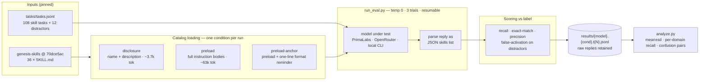

<picture>
  <source media="(prefers-color-scheme: dark)" srcset="assets/primalabs-logotype-white.svg">
  
</picture>

# Genesis-SkillEval

**An open benchmark from [PrimaLabs AI](https://primalabs.ai):** routing and compliance evaluation for [Genesis Agent Skills](https://gitlab.osti.gov/genesis/genesis-skills) (DOE Genesis Mission / ModCon) across open and closed models. Not affiliated with or endorsed by the U.S. Department of Energy.

**Headline:** on the 36-skill Genesis catalog, NVIDIA's open-weight Nemotron 3.5 Super VL achieves the highest exact-match skill routing of ten models (twelve model×serving endpoints) measured — above GPT-5.2, Claude Opus 5.5, Claude Sonnet 5.5, and Gemini 3.5 Flash; on neutral serving it is in a statistical three-way tie with the strongest other open models (Reflection Beam 1.0, Kimi K3.1 Pro) — on both PrimaLabs serving (0.830) and neutral third-party serving (0.753).

- Full methods, results, findings, caveats: [`report.md`](report.md)
- Broad-audience brief: [`brief-genesis-science-agents.md`](brief-genesis-science-agents.md)
- Serving bug found during the study: [`bug-supervl-tool-tag-loop.md`](bug-supervl-tool-tag-loop.md)

## Background: why this study exists

The [Genesis Mission](https://www.energy.gov/undersecretaryforscience/genesis-mission/genesis-mission) is DOE's program to deploy AI agents across the national laboratory system — agents that plan experiments, steer simulations, submit jobs to supercomputers like Frontier and Perlmutter, and move data through the American Science Cloud. In October 2026, DOE released [Genesis Agent Skills](https://gitlab.osti.gov/genesis/genesis-skills): the first shared catalog of validated agent workflows for this ecosystem, built by the laboratory system under ModCon. Each skill is a `SKILL.md` file (the [agentskills.io](https://agentskills.io) format) encoding a vetted procedure — how to submit a Slurm job, run uncertainty quantification, generate a data card, red-team an agent before it touches controlled data.

A catalog only helps if the agent picks the right entry. Every agent action starts with a routing decision: *this request needs the Slurm skill, not the PBS skill.* Route wrong and the agent improvises exactly where DOE built the catalog to stop improvisation; activate three skills instead of one and the agent acquires tool permissions and context it shouldn't have, in deployments where actions are audited and data may be export-controlled. For science agents, skill routing is a safety and reproducibility property — and until this study, nobody had measured it.

Three questions this benchmark answers:

1. **Which models route the Genesis catalog reliably?** Relevant because the mission's hardest deployments (air-gapped enclaves, export-controlled data) can only use open-weight models — so it matters whether the open path costs capability. (It doesn't: see results.)
2. **Does the skill spec's loading convention — progressive disclosure — hold up?** It predates 1M-context models and cheap prompt caching; we test it against full-catalog preloading.
3. **Do models keep following agent protocols under a full catalog's instruction load?** Governed agents depend on parseable outputs; we measure protocol breakdown, not just routing accuracy.

## Results (exact-match, best config per model, mean±sd over 3 trials, temp 0)

| model | serving | exact | recall |
|---|---|---|---|
| Nemotron 3.5 Super VL (open) | PrimaLabs NVFP4 | **0.830 ± 0.019** | 0.981 ± 0.010 |
| Reflection Beam 1.0 (open) | OpenRouter | 0.756 ± 0.019 | 0.997 ± 0.005 |
| Nemotron 3.5 Super VL (open) | OpenRouter | **0.753 ± 0.014** | 0.938 ± 0.019 |
| Kimi K3.1 Pro (open) | OpenRouter | 0.747 ± 0.014 | 0.981 ± 0.010 |
| Nemotron 3.5 Lightning (open) | PrimaLabs NVFP4 | 0.738 ± 0.027 | 0.855 ± 0.019 |
| GPT-5.2 | OpenRouter | 0.716 ± 0.014 | 0.947 ± 0.014 |
| Nemotron 3.5 Lightning (open) | OpenRouter | 0.707 ± 0.005 | 0.827 ± 0.019 |
| Claude Opus 5.5 | OpenRouter | 0.679 ± 0.005 | 0.997 ± 0.005 |
| Gemini 3.5 Flash | OpenRouter | 0.663 ± 0.011 | 0.978 ± 0.005 |
| GLM-5.3-Flash (open) | PrimaLabs | 0.657 ± 0.016 | 0.991 ± 0.010 |
| Claude Sonnet 5.5 | OpenRouter | 0.639 ± 0.000 | 0.994 ± 0.005 |
| MiMo-V2.6-Pro (open) | PrimaLabs | 0.543 ± 0.023 | 1.000 ± 0.000 |

## How the harness works

Given a scientist's natural-language request and the skill catalog, does the model activate **exactly** the right skill?



### Task set

120 tasks in `tasks/tasks.jsonl`: 3 per skill (108) plus 12 distractors that need no skill. Generated by DeepSeek-V4.1 (a different family than any evaluated model, to avoid self-generation bias) from each skill's description and instruction body, at varied specificity — at least one task per skill is indirect, where the user doesn't know a specialized workflow exists. Each row: `{id, task, required, domain}`; distractors have `required: null`.

### Activation eval (`run_eval.py`)

The model is prompted as a router: a system prompt presents the catalog in one of three loading conditions and asks for `{"skills": [...]}` (exact names, empty list if none). The user turn is the raw task text. One call per task; temperature 0; `max_tokens` 16384 so reasoning models can think before answering.

Conditions differ only in how the catalog appears in the system prompt (built by `catalog.py`):

| condition | catalog representation | size |
|---|---|---|
| `disclosure` | `<skill>` name + description only — the agentskills.io progressive-disclosure convention | ~3.7k tokens |
| `preload` | name + description + full SKILL.md instruction body per skill | ~63k tokens |
| `preload-anchor` | preload, plus one line appended to the user turn: *"Remember: reply with JSON only, {\"skills\": [...]} — do not answer the request itself."* | ~63k tokens |

Scoring per task compares the parsed selection to the label:

- **recall** — required skill ∈ selected
- **exact-match** — selected == [required], nothing else (the headline metric: every extra activation costs context, tool permissions, and audit surface)
- **precision** — hits / total selections (penalizes spraying)
- **false-activation** — any selection on a distractor task, *including* protocol violations
- replies that are not parseable JSON are recorded as `<unparseable>` and count as false activations on distractors — a model that answers the question instead of routing has broken the agent contract, which is the failure the metric exists to catch

Each trial writes raw rows (selection + last 500 chars of the reply) to `results/<model>.<condition>.t<N>.jsonl`; `--resume` skips files that exist, so interrupted runs never re-bill. `analyze.py` aggregates mean±sd across trials, per-domain recall, and a confusion table (required skill → what was selected instead).

### Execution eval (`exec_eval.py`)

Separate question: once the right skill is in context, does the model *follow* it? One task per skill (36). The model gets the full SKILL.md as its system prompt and performs the task; GLM-5.3-Flash then judges the response against the skill's own instructions on adherence / correctness / completeness (1–5 each), returning one evidence sentence per verdict. The judge is a different model family from the headline subjects to limit self-preference. Chat-only — skills that prescribe running scripts are penalized for every model, so scores are a lower bound until a tool-loop harness exists.

### Client (`client.py`)

One `chat()` entry point routes by model id: `primalabs-ai/*` → PrimaLabs endpoint, `cli/claude/*` / `cli/codex/*` → local subscription CLIs (harness-level numbers, reported separately), anything else → OpenRouter. Anthropic models get `cache_control` on the catalog block automatically (the 63k-token preload bills at cache-read rates after the first call). Retries survive rate limits (429 backoff up to 60s) and multi-minute network outages (exponential up to 120s, 10 attempts); a task that still fails is recorded as `<error>` rather than aborting the trial.

## Reproduce

### Requirements

- Python 3.9+ (stdlib only, no pip installs)
- git
- Keys in `.env` (copy `.env.example`):
  - `PRIMALABS_BASE_URL`, `PRIMALABS_API_KEY` — open-model runs on PrimaLabs
  - `OPENROUTER_API_KEY` — closed-model and neutral-serving runs (full slate ≈ $60 with prompt caching; Anthropic `cache_control` is applied automatically)

### Pinned inputs

Reproducibility depends on three pinned artifacts, all in this repo or pinned by `scripts/reproduce.sh`:

| artifact | pin |
|---|---|
| Skill catalog | `genesis-skills` @ `70dce5ac` (2026-10-29); the script checks this out |
| Task set | `tasks/tasks.jsonl` (committed). **Do not regenerate** for comparison runs — `gen_tasks.py` samples at temperature 0.7 and produces a different set |
| Decoding | temperature 0, `max_tokens` 16384, 3 trials per condition |

Known nondeterminism: provider-side serving is not bit-reproducible at temperature 0 (we measured ±2–5pp across trials — hence 3 trials with mean±sd), and OpenRouter does not pin the underlying provider for open models. Model aliases resolve at call time; our runs used the model ids exactly as listed in `results/*.summary.json` on 2026-11-04/05.

### Run

```bash
git clone git@github.com:PrimaLabs-AI/genesis-skilleval.git && cd genesis-skilleval
cp .env.example .env   # fill in keys

SMOKE=1 ./scripts/reproduce.sh   # free-ish 8-task sanity check (~1 min)
./scripts/reproduce.sh           # full matrix (~2-3 h wall, ≈$60 OpenRouter + PrimaLabs usage)
```

All runs are resumable: per-trial results land in `results/<model>.<condition>.t<N>.jsonl` and `--resume` skips completed files, so interruptions never re-bill finished work.

Single model / condition:

```bash
python3 skilleval/run_eval.py --model nvidia/nemotron-3.5-super-vl --condition preload --trials 3 --resume
python3 skilleval/analyze.py > results/analysis.md
```

Model id routing: `primalabs-ai/*` → PrimaLabs endpoint; anything else → OpenRouter; `cli/claude/<model>` and `cli/codex/<model>` → local subscription CLIs (optional; harness-level numbers, reported separately in `report.md`).

### Verify against our numbers

`results/` contains every raw per-trial file from the published runs (including model replies, truncated to 500 chars). `python3 skilleval/analyze.py` regenerates all tables in `report.md` from them. A fresh run should match the committed means within the per-trial sd shown in `results/analysis.md`.

## Repo map

| path | contents |
|---|---|
| `skilleval/catalog.py` | SKILL.md discovery/parsing, disclosure + preload prompt blocks |
| `skilleval/client.py` | multi-provider chat client (PrimaLabs, OpenRouter, subscription CLIs), retries, Anthropic cache_control |
| `skilleval/gen_tasks.py` | task-set generator (DeepSeek as generator; only for building *new* task sets) |
| `skilleval/run_eval.py` | activation eval, 3 conditions, resumable trials |
| `skilleval/exec_eval.py` | execution pilot with LLM judge |
| `skilleval/analyze.py` | aggregate tables, per-domain recall, confusion pairs |
| `tasks/tasks.jsonl` | the 120 labeled tasks used in all published runs |
| `results/` | raw per-trial results + aggregate `analysis.md` |
| `scripts/reproduce.sh` | one-command reproduction (pins catalog, runs matrix, aggregates) |

## Caveats

Synthetic task set (DeepSeek-generated; human audit pending), single-label ground truth (deflates exact-match for legitimately multi-skill tasks), execution eval is chat-only, OpenRouter provider not pinned for open-model replication runs. Full list and discussion in `report.md`.

## Authors

- **Prasanna Balaprakash** — Co-Founder & CEO, [PrimaLabs AI](https://primalabs.ai)

Benchmark design, harness, and analysis by PrimaLabs AI. Contributions welcome via issues and pull requests.

## Citation

If you use Genesis-SkillEval, the task set, or the published results, please cite:

```bibtex
@misc{balaprakash2026genesisskilleval,
  title        = {Genesis-SkillEval: A Routing and Compliance Benchmark for
                  Genesis Agent Skills Across Open and Closed Models},
  author       = {Balaprakash, Prasanna},
  year         = {2026},
  month        = nov,
  publisher    = {PrimaLabs AI},
  howpublished = {\url{https://github.com/PrimaLabs-AI/genesis-skilleval}},
  note         = {Benchmark harness, task set, and results for the DOE Genesis
                  Mission Agent Skills catalog (genesis-skills @ 70dce5ac)}
}
```

Please also cite the skill catalog this benchmark evaluates: *Genesis Agent Skills*, developed by the BASE team within ModCon (Transformational AI Models Consortium), DOE Genesis Mission — https://gitlab.osti.gov/genesis/genesis-skills.

## Acknowledgments

This benchmark evaluates the **Genesis Agent Skills** catalog produced by the U.S. Department of Energy's **Genesis Mission** through **ModCon: Transformational AI Models and Data** and the Baseline AI R&D Capabilities (BASE) team — a collaboration across the DOE National Laboratory system, co-led by Nathan Hodas (PNNL) and Stefan Wild (LBNL), with catalog contributions from PNNL, LBNL, PPPL, ORNL, ANL, Jefferson Lab, and the American Science Cloud teams. We thank the catalog's contributors for releasing it openly; this independent evaluation would not exist without that release.

PrimaLabs AI participates in DOE Genesis Mission projects led by Savannah River National Laboratory — **VITA-SCALE** and **SCOPE**, supporting DOE's Office of Environmental Management.

This work was performed and funded by PrimaLabs AI. It is not a product of, affiliated with, or endorsed by the U.S. Department of Energy; all findings and any errors are our own.

## License

Apache-2.0 (see `LICENSE`). The evaluated skill catalog is separately licensed by its authors (BSD-2-Clause, ModCon) and is not redistributed in this repository.
